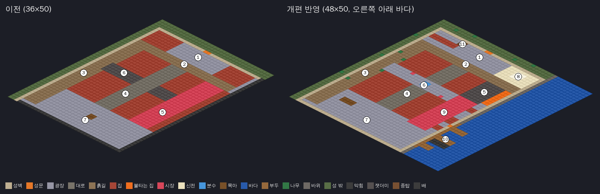

# 챕터 1 맵 — 트로이 (개편 반영)

> **반영됨.** 아래 개편안대로 `chapter1_troy.gd`의 `build()`를 다시 짰다(48×50). 새 소품·바닥은 받기 전이라
> `tools/gen_env_extra.py`의 임시 생성 그림이고, `troy_city`·`troy_coast`를 받으면 같은 이름으로 덮어쓴다.
> 개편안과 달라진 점은 §5에 적었다. 맵 화면 확인: `godot --path . -- --play --god --at=37,38`(부두) · `--at=29,10`(신전) · `--at=18,26`(분수).

참고 그림: [`references/environment/ch1_troy__city-layout.webp`](../references/environment/ch1_troy__city-layout.webp)
(성벽에 둘러싸인 해안 도시를 내려다본 그림. 목마·분수 시장·신전·불타는 구역·항구가 다 들어 있다).
지금 맵 코드는 `scripts/world/chapter1_troy.gd`의 `build()`. 배치도는 `python3 tools/gen_map_plan.py .`로 다시 그린다.

## 1. 참고 그림에서 가져올 것 / 가져오지 않을 것

| 가져온다 | 가져오지 않는다 |
|---|---|
| 도시 구성: 성벽 + 네모 성탑, 성문 옆 나무 종탑, 언덕 위 신전, 가운데 분수 광장과 좌판, 불타는 구역, 항구 | 해 질 녘 금빛 조명. 챕터 1은 **밤**이다(남색 바탕 + 주황 불빛, ART_PLAN §1) |
| 재질과 색: 밝은 사암 벽, 붉은 기와 지붕, 붉은 바탕에 금 무늬 깃발, 사이프러스·올리브 나무, 화분 | 그림 전체를 배경으로 깔기. 모든 맵은 타일·소품으로 걸어 다닐 수 있게 만든다(GAME_DESIGN "지킬 것") |
| 목마 옆에 기댄 사다리와 상자 — 오디세우스가 내려오는 장면에 그대로 쓴다 | 그림 속 칸 크기·세밀함. 그림은 `troy_env.webp` 화풍(64×32 칸)에 맞춰 새로 받는다 |
| 바다를 맵 경계로: 보이지 않는 벽 대신 바위 해안·바다가 길을 막는다 | 목마와 성문이 바로 붙어 있는 배치. 게임에서는 잠입 거리가 있어야 하므로 지금처럼 맵 반대쪽 끝에 둔다 |

**깃발 색**: 참고 그림의 트로이 깃발도 붉은 바탕에 금 무늬라 지금 `banner_troy`와 같다. 트로이 병사 옷 색(진보라 제안, ART_PLAN §1.3)과는
따로 정해도 된다 — 깃발은 도시, 옷은 군대.

## 2. 지금 맵과 비교

| 번호 | 구역 | 지금 | 개편안 |
|---|---|---|---|
| 1 | 성문 광장 | 광장 + 권양기 + 경비대 | 그대로. 서쪽에 **나무 종탑(11)** |
| 2 | 북쪽 가로 | 흙길, 끝마다 신호 횃불 | 그대로. 동쪽 끝이 신전 계단 밑으로 이어짐 |
| 3 | 서쪽 뒷골목 | 어두운 흙길 + 무기고 | 계단식 주택가 느낌: 사이프러스·화분·돌계단(장식) 추가. 나무가 시야를 가리는 엄폐물 |
| 4 | 가운데 대로 | 횃불이 늘어선 길 | 그대로 |
| 5 | 동쪽 길 | 짐더미 시장 | 위쪽 절반은 **불타는 구역**(불탄 집·부러진 기둥·돌무더기, 밝아서 멀리 보임), 아래쪽 절반은 시장(9) |
| 6 | 가운데 가로 | 잿더미 가로 | **둥근 분수 광장** + 붉은·흰 차양 좌판. 세 갈래가 만나는 곳이라 순찰이 겹친다 |
| 7 | 목마 광장 | 가운데에 목마 | 목마를 서쪽 성벽 가까이 옮기고 **사다리**를 기댐(시작 장면). 기둥·상자 |
| 8 | (새) 신전 언덕 | 집 두 채 | 성문 광장 동쪽 높은 터 위 **아테나 신전** + 사자상 + 둥근 모자이크 바닥. 사수 2파의 궁수가 신전 계단에 선다(지금 `PERCH_CELLS`의 동쪽 짐더미 대신) |
| 9 | 시장 | 동쪽 길 전체 | 동쪽 길 아래쪽 절반으로 줄임 |
| 10 | (새) 항구 | 보이지 않는 벽 | 동쪽 성벽의 **바다 문** 밖 부두 + 배. 묶인 정찰병을 부두 끝에 둔다(지금은 시장 동쪽 막다른 골목) |
| — | 맵 가장자리 | 위쪽 두 변만 성벽, 아래쪽 두 변은 보이지 않는 벽 | 네 변 모두 성벽. 오른쪽 아래 밖은 바위 해안·바다, 위쪽 밖은 흙길·소나무·바위 |

맵 크기 36×50 → **42×50** (x 36~41이 해안·바다). 성문·권양기·세 갈래 길·신호 횃불·경보 종의 칸 좌표는 그대로 둔다 —
봇 경로(`--auto`, `--auto=stealth`)와 체크포인트가 이 좌표를 쓰기 때문이다. 바뀌는 좌표는 아래 셋뿐이다.

| 상수 | 지금 | 개편안 |
|---|---|---|
| 목마 `add_prop("horse", …)` | (19, 42) | (9, 41), 사다리 (11, 42) |
| `SCOUT_CELL` | (34.3, 27.8) | 부두 끝 (39.5, 38.5) — 바다 문 (35, 39) 지나서 |
| `PERCH_CELLS` | (12,10), (24,10) | (12,10), 신전 계단 (27, 9) |

## 3. 만들 때 조심할 것

- **앞쪽 성벽이 사람을 가린다.** 화면 아래쪽 두 변(x=35, y=49)에 성벽을 세우면 깊이 정렬상 그 앞을 지나는 오디세우스가 가려진다.
  앞쪽 두 변은 반 높이 성벽을 쓰거나, 오디세우스가 가까이 오면 반투명하게 한다(`IsoLevel`에 한 번만 만들면 다른 챕터도 쓴다).
- **높낮이는 아직 없다.** 신전 언덕·주택가 계단은 M2 "높낮이"(ROADMAP) 전까지 바닥 높이 그대로, 계단은 장식 그림으로만 둔다.
  M2 뒤에 신전 터를 1층으로 올리면 궁수가 내려다보는 자리가 진짜 높은 곳이 된다.
- **바다**: 물 칸은 지나갈 수 없게(`set_solid`). 파도 거품은 바위 해안 칸에 그림으로만.
- **불타는 구역**: 불 소품이 많으면 밝은 곳이 늘어 잠입이 어려워진다 — 동쪽 길은 "빠르지만 밝은 길"로 일부러 남기고,
  `--auto=stealth`가 alarms 0으로 끝나는지 꼭 본다.
- 순서: 그림(§4)을 받기 전에도 바닥·바다·성벽·좌표 이동은 지금 그림으로 먼저 할 수 있다. 신전·분수·종탑·부두는 그림을 받은 뒤.

## 4. 필요한 그림

ART_PLAN §4.4의 `E-TROY-*` 새 항목. 프롬프트는 [../sprite_request/environment.md](../sprite_request/environment.md) §3·§4.

| 시트 | 내용 |
|---|---|
| `troy_city.webp` | 아테나 신전(3×3칸), 신전 계단, 사자상, 분수(2×2칸), 차양 좌판 2색, 나무 종탑(2×2칸), 목마 사다리, 부러진 기둥, 성벽에 거는 깃발, 반 높이 성벽 |
| `troy_coast.webp` | 바다 타일(4변형), 바위 해안 타일, 나무 부두 타일·말뚝, 갤리선(5×2칸), 작은 배, 바위, 사이프러스·올리브·소나무, 화분, 모자이크 바닥 |

## 5. 만들면서 바꾼 것 (개편안 → 실제)

| 항목 | 개편안 | 실제 | 까닭 |
|---|---|---|---|
| 맵 크기 | 42×50 | **48×50** (x 36~47 바다) | 엔딩에 갤리선이 바다로 나아갈 자리. 맵 밖 검은 곳이 안 보이게 |
| 바다 문 | (35, 39) | **(35, 33)** — 시장 남쪽 골목(y33~34) 끝 | (35,39)이면 목마 광장 바로 옆이라 정찰병 구출이 너무 쉽다. 시장을 지나야 닿게 |
| 부두 | x37~ 부두 셋 | 성벽 길 x36 y31~45 + 부두 y33~34 · y38~39 · y43~44, 갤리선 (37,40) 5×2 | 정찰병은 가운데 부두 끝 (40.4, 38.6), 보초 하나가 부두 끝 쪽을 보고 선다(성벽 길로 오면 등 뒤) |
| 분수 광장 | y21~26 넓은 광장 | 원래 가운데 가로 **y22~25를 광장으로**, 분수는 대로 한가운데 (17,23) 2×2 | 집 배치·잠입 균형을 그대로 두려고. 순찰병은 분수를 돌아간다(A*) |
| 나무 종탑 | (13, 4) 성문 서쪽 | **(10, 4)** 광장 밖 서쪽 | (13,4)에 두면 경비대 싸움터를 막아 봇이 한 번 졌다 |
| 대로 경보 종 | — | (20, 23) 그대로 | (21,23)으로 옮기면 봇이 경보병을 못 따라가 경보가 울렸다(8번 중 3번) |
| 신전 | 3×3 + 계단 | 신전 (29,5) 3×3, 계단 (29~31, 8), 사자상 (28,8)·(32,8), 사이프러스 둘 | 반격 2파 궁수는 계단 가운데 (30, 8)에 선다 |
| 목마 | (9, 41), 사다리 (11, 42) | 목마 (9,41) 4×2, 사다리 **(13, 41)** | 사다리를 목마 발자국 밖으로. 오디세우스는 (13.8, 43.2)에서 시작, 시논은 그 옆 |
| 연습 보초 | — | 조용히 처치 연습 (21.5, 44.5) 동쪽을 봄 | 시작 자리가 서쪽으로 옮겨져서, 다가가는 쪽이 등 뒤가 되게 |
| 앞쪽 성벽 | 반 높이 또는 반투명 | **반투명**(기존 가림 투명화 `occluders`) | 반 높이 성벽 그림 없이 바로 됨 |
| 불타는 구역 | 동쪽 길 위쪽 | x27~32 y13~21 잿더미 바닥 + 동쪽 끝 집 둘 처음부터 불탐, 부서진 기둥·돌무더기. 가운데 x29~30은 반격 무리가 지나가게 비움 | |

검증: `--auto` 7번·`--auto=stealth` 2번 모두 엔딩까지(경보 0), 시작 자리에서 정찰병·무기고·신전 계단·신호 횃불까지 길이 이어짐.
